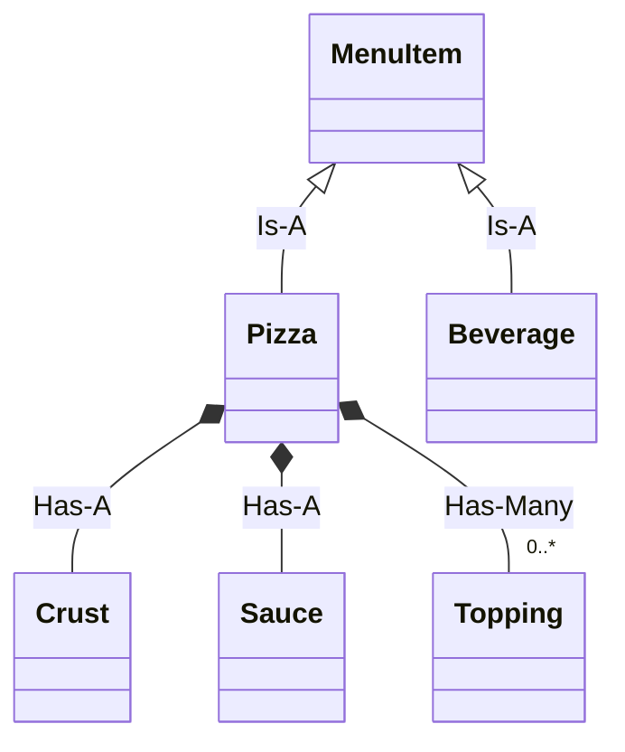

# Milestone 03: Inheritance vs. Composition ("Is-A" vs "Has-A")

## 🎯 The Core Insight from Cloud X Berry
Around 7 minutes into the video, Cloud X Berry addresses the trap most beginner OOP programmers fall into:

### The "Class Explosion" Anti-Pattern
You start modeling your menu:
- `PepperoniPizza` inherits from `Pizza`
- `StuffedCrustPepperoniPizza` inherits from `PepperoniPizza`
- `GlutenFreeStuffedCrustPepperoniPizza` inherits from ... what?!

If you have 4 crusts, 3 sauces, and 10 toppings, you would need **120 subclasses**!

```
                  [ Pizza ]
                     |
       +-------------+-------------+
       |                           |
[ PepperoniPizza ]          [ VeggiePizza ]
       |                           |
[ StuffedCrust... ]         [ GlutenFree... ]
       |                           |
  (CLASS EXPLOSION - CODEBASE CRUMBLES)
```

---

## 💡 The Software Engineering Rule: Favor Composition Over Inheritance

Ask two questions:
1. **"Is it an X?"** (Inheritance: *Is-A* relationship)
   - A `Pizza` *is a* `MenuItem`.
   - A `Soda` *is a* `MenuItem`.
   - *Use Inheritance here!* Both share common menu item properties (name, sku, category).

2. **"Does it have an X?"** (Composition: *Has-A* relationship)
   - A `Pizza` *has a* `Crust`.
   - A `Pizza` *has a* `Sauce`.
   - A `Pizza` *has* zero or more `Toppings`.
   - *Use Composition here!* Instead of making subclasses, pass component objects into the Pizza.



---

## 🔨 Your Exercise
Open [exercise.py](file:///home/dominicnyabuto/Code/00_Coding_Fundamentals/OOPs/03_composition_over_inheritance/exercise.py).
1. Create `Crust`, `Sauce`, and `Topping` component classes.
2. Create base `MenuItem` and inherit it in `Pizza` and `Beverage`.
3. Compose `Pizza` using `Crust`, `Sauce`, and `Topping` instances.

Run:
```bash
python3 test_milestone.py
```
