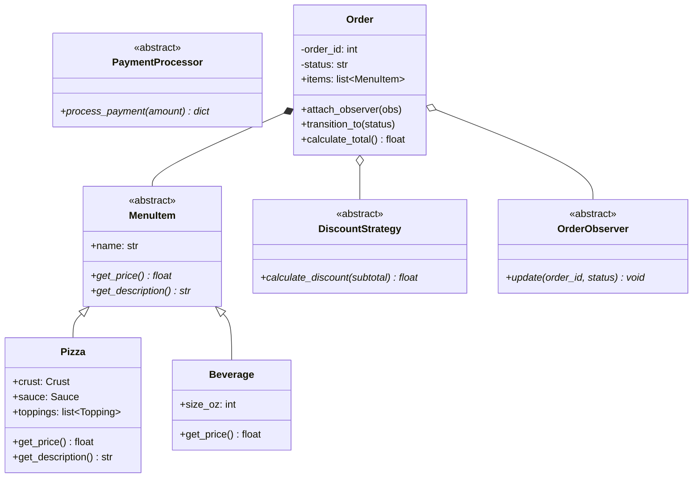

# Milestone 09: Capstone — The Complete Berry's Pizzeria Engine

Congratulations on reaching the Capstone! In this final milestone, all OOP concepts you have practiced unite into an end-to-end, object-oriented food ordering and dispatch application.

---

## 🏗️ Architecture Overview



---

## 🚀 Running the Capstone

You can run the interactive ordering CLI demo:
```bash
python3 berrys_pizzeria.py
```

Or run the end-to-end integration test suite:
```bash
python3 test_capstone.py
```

